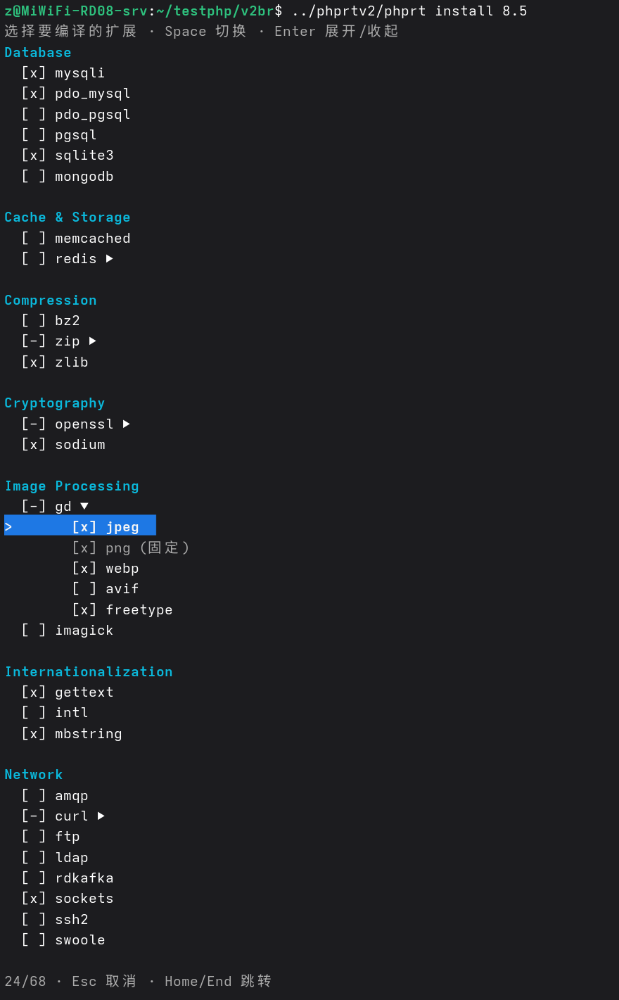
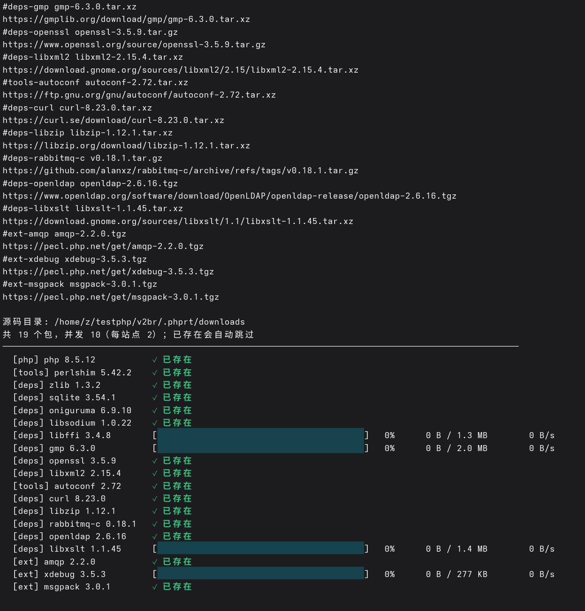

# phprt

phprt 是一个给 PHP 项目准备运行环境的构建脚本，用法类似 Python 的 uv。
一条命令装好 PHP、依赖库和扩展，全部放在项目自己的 `.phprt/` 里，不往系统目录
写文件，也不依赖系统里已装的库版本。不同项目互不影响，运行时不用设置环境变量。

## 安装依赖

```bash
sudo dnf install gcc gcc-c++ make cmake pkgconf-pkg-config patchelf \
    tar xz unzip binutils m4 perl curl
```

## 快速开始

在项目目录里装 PHP：

```bash
cd ~/blog
/path/to/phprt/phprt install 8.5
```



只想先把源码下载好、以后再编译：

```bash
/path/to/phprt/phprt install 8.5 --downloads
```



装好后项目里会多一个 `./myphp`，用它跑 PHP：

```bash
./myphp -r 'var_dump(phpinfo());'
```

## 使用说明

完整用法见 [docs/GUIDE.md](docs/GUIDE.md)：

1. [安装与构建](docs/GUIDE.md#1-安装与构建)
2. [只下载源码与离线构建](docs/GUIDE.md#2-只下载源码与离线构建)
3. [扩展选择菜单](docs/GUIDE.md#3-扩展选择菜单)
4. [扩展清单与编译方式](docs/GUIDE.md#4-扩展清单与编译方式)
5. [目录结构与配置](docs/GUIDE.md#5-目录结构与配置)
6. [升级 PHP 与依赖更新](docs/GUIDE.md#6-升级-php-与依赖更新)
7. [buildroot 隔离构建](docs/GUIDE.md#7-buildroot-隔离构建)
8. [单文件 PHP 与全静态](docs/GUIDE.md#8-单文件-php-与全静态)
9. [命令速查](docs/GUIDE.md#9-命令速查)

## 扩展支持

扩展支持：Database(mysqli pdo_mysql pdo_pgsql pgsql sqlite3 mongodb)、Cache & Storage(apcu memcached redis)、Messaging(amqp rdkafka)、Network(curl ftp ldap sockets ssh2)、Runtime(pcntl posix readline shmop swoole sysvmsg sysvsem sysvshm)、Serialization & Data Formats(igbinary msgpack protobuf yaml)、Compression(bz2 zip zlib)、Cryptography(openssl sodium)、Image Processing(gd imagick)、Internationalization(gettext intl mbstring)、XML & Documents(libxml2 xsl tidy)、Other(ffi gmp xdebug)。

## 项目特点

1. **依赖与系统环境隔离**：PHP 和扩展只用项目自己的库，系统升级 libssl、libcurl 不影响项目。
2. **可提前下载源码后离线构建**：先 `install --downloads`，断网也能装。
3. **扩展丰富**：30 个内置扩展 + 14 个 PECL 扩展，默认集开箱即用。
4. **扩展 recipe 化**：每个扩展一份 recipe，用契约描述依赖、编译参数和 ini，构建流程与数据解耦。
5. **buildroot 可选独立环境**：需要干净构建时创建 chroot，用完直接删 rootfs 目录；编译工具 gcc、tar 等装在 rootfs 里，不影响原系统。

## 注意事项与说明

本项目由 newcloud 与 DeepSeek V4.1 Flash 1017 共同开发。
当前没有在线生产环境使用过！只在 Fedora 43 上测试过！

## 协议

[Mozilla Public License 2.0](LICENSE)
